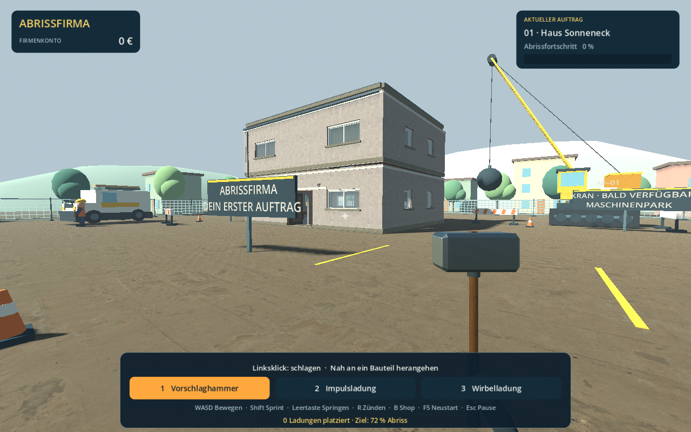

# Abrissfirma

Ein spielbarer 3D-Prototyp für Windows mit überarbeiteter Architektur und Zerstörung: Erkunde ein leer stehendes Haus,
zerstöre es mit Werkzeugen und fiktiven Geräten, verdiene Geld und verbessere
deine Ausrüstung. Das Projekt verwendet Godot 4 und GDScript.



## Windows-Version herunterladen

Die spielbereite Ausgabe wird unter **Releases** dieses GitHub-Projekts als
`Abrissfirma-Spielbereit.zip` bereitgestellt. ZIP entpacken und
`Abrissfirma.exe` doppelt anklicken. Dafür ist kein Godot-Editor erforderlich.

## Direkt im Browser spielen

[Abrissfirma im Browser öffnen](https://vbl4cks.github.io/abrissfirma/).
Die erste Ladephase überträgt rund 52 MB. Benötigt werden ein aktueller
Desktop-Browser mit WebGL 2 sowie Tastatur und Maus. Die Browserfassung ist
eine zusätzliche Testversion; die Windows-Ausgabe bleibt separat verfügbar.
Spielstände werden im jeweiligen Browser gespeichert und nicht mit der
Windows-Version synchronisiert. Beim Löschen der Websitedaten gehen sie verloren.

## Quellcode öffnen

Godot **4.7.2** von [godotengine.org](https://godotengine.org/download/windows/)
herunterladen, dieses Repository klonen oder als ZIP entpacken und
`project.godot` in Godot importieren. **F5** startet das Spiel.

Die großen Engine- und Exportdateien unter `tools/` sowie die fertige
Windows-Anwendung sind absichtlich nicht Teil des Quellcode-Repositories.

## Starten – ohne Programmierkenntnisse

Die fertige Windows-Ausgabe liegt in **Spielbereit/Abrissfirma.exe**.
Zum Weitergeben oder Entpacken steht **Abrissfirma-Spielbereit.zip** bereit.
ZIP entpacken und **Abrissfirma.exe** doppelt anklicken. Für diese Ausgabe
ist keine Godot-Installation erforderlich. Texturen, Geräusche und Spiellogik
sind in der Anwendung enthalten.

Die folgenden Schritte starten alternativ die bearbeitbare Projektfassung:

1. Öffne diesen Projektordner im Windows-Explorer.
2. Doppelklicke auf **STARTEN.bat**.
3. Klicke im Spiel auf **„Auftrag annehmen und loslegen“**.
4. Laufe zum Haus und probiere zuerst den Hammer aus.

In der ursprünglichen lokalen Arbeitskopie liegt Godot **4.7.2 für Windows**
bereits im Ordner `tools/godot` bereit. Bei einem neuen GitHub-Clone wird
Godot wie oben beschrieben separat heruntergeladen.
Eine zusätzliche Installation, Eclipse oder .NET ist zum Spielen nicht nötig.
Das Projekt verwendet den **Compatibility-Renderer**.

Zum Bearbeiten doppelklickst du auf **IM_EDITOR_OEFFNEN.bat**. Im Godot-Editor
startest du das Spiel mit **F6** für die geöffnete Szene oder **F5** für das Projekt.
Alternativ kannst du `project.godot` mit Godot importieren und öffnen.

## Steuerung

| Taste / Maus | Funktion |
| --- | --- |
| W, A, S, D | Bewegen |
| Maus | Umsehen |
| Leertaste | Springen |
| Umschalt / Shift | Sprinten |
| 1 | Vorschlaghammer auswählen |
| 2 | Orange Impulsladung auswählen |
| 3 | Violette Wirbelladung auswählen |
| Mausrad | Werkzeug wechseln |
| Linke Maustaste | Schlagen oder Gerät an einem Hausbauteil platzieren |
| R | Alle platzierten Geräte gemeinsam zünden |
| B | Werkstatt / Shop öffnen |
| Esc | Pause öffnen oder Menü schließen |
| F5 | Laufenden Auftrag neu starten, Werkzeugvorrat auffüllen |

Die F5-Funktion in dieser Tabelle gilt im laufenden Spiel. Im Editor startet F5 das Projekt.
Mausempfindlichkeit und drei Grafikstufen lassen sich im Pausenmenü einstellen.
Mittel ist die Voreinstellung für die GTX 1050 Ti. Niedrig reduziert Schatten,
Sichtweite und aktive Bruchstücke; Hoch erhöht die Schattenreichweite und das Physikbudget.

## Deine erste Spielrunde

- Ziele mit dem Fadenkreuz auf Wände, Böden, Fenster oder Einrichtung des Hauses.
- Der Hammer funktioniert aus kurzer Entfernung und kostet keinen Vorrat.
- Du beginnst mit **12 Impuls- und 6 Wirbelladungen**. Platziere sie mit Linksklick
  und zünde sie mit R. Orange stößt Trümmer auseinander, Violett zieht sie zusammen.
- Hammerschläge erzeugen örtliche Ausbrüche und Risse. Putz, Mauerwerk, Beton,
  Holz und Glas besitzen unterschiedliche Bruchformen; abgetrennte Teile fallen herunter.
- Erreiche **72 % Abrissfortschritt**, um den Auftrag abzuschließen.
- Der erste Auftrag zahlt **1.200 €**, dazu **10 € je unbenutzter Ladung**.
- Nach dem Ergebnis kannst du weiter erkunden oder den nächsten Auftrag annehmen.
  Im Shop findest du den Knopf für einen neuen Auftrag ebenfalls.
- Folgeaufträge erhöhen die Grundprämie schrittweise bis auf **2.000 €**.

| Verbesserung | Preis | Wirkung |
| --- | --- | --- |
| Verstärkter Hammer | 450 € | Mehr Schaden pro Schlag |
| Impulsverstärker | 700 € | Größere Reichweite und mehr Schaden für beide Geräte |
| Leichte Arbeitsstiefel | 350 € | Schneller laufen |

## Was bereits enthalten ist

- Begehbares Haus mit zwei Etagen, Wandstärken, Fensterrahmen, Laibungen,
  offenen Doppeltüren, Dachabschluss, Bodenbelägen und eingerichteten Räumen.
- Ich-Perspektive, überarbeiteter Hammer mit Handschuh und zwei kompakte Spielgeräte.
- Echte CC0-PBR-Texturen für Putz, Beton, Holz und Ziegel; originale CC0-Aufprallgeräusche.
- Örtliche Abplatzungen, geschlossene unregelmäßige Bruchstücke und weicher Staub.
- Vereinfachte, richtungsabhängige Stützverbindungen und zeitlich fortschreitender Einsturz.
- Auftragsziel, Auszahlung, Shop und gespeicherte Verbesserungen.
- Sonnige Baustelle mit Zäunen, Schildern, Servicewagen, Arbeitern und einem Kran.
- Dauerhaft sichtbarer Schutt; begrenzte aktive Physik und gebündelte ruhende Bruchstücke.

## Speichern

Guthaben, gekaufte Verbesserungen und abgeschlossene Aufträge werden automatisch
nach Auszahlung oder Kauf gespeichert. Die Zerstörung des laufenden Hauses und
die Position des Spielers werden derzeit **nicht** gespeichert.

Der Spielstand heißt `abrissfirma_save.json`. Unter Windows liegt er üblicherweise hier:

```text
%APPDATA%\Godot\app_userdata\Abrissfirma\abrissfirma_save.json
```

Godot bezeichnet diesen Speicherort intern als `user://abrissfirma_save.json`.

## Aktuelle Grenzen

- Es gibt **einen Hausgrundriss**. Folgeaufträge variieren Titel, Farben und Prämie.
- Kran, Abrissbirne, Servicewagen und Arbeiter sind gestaltete Kulisse.
  Fahrzeuge lassen sich noch nicht steuern und Mitarbeiter haben noch keine Aufgaben.
- Der Einsturz basiert auf einfachen Bauteilverbindungen; eine technische
  Statikberechnung oder frei verformbare Materialien sind nicht enthalten.
- Trümmer werden erst bei Ruhe auf festen Unterlagen bzw. abgestütztem Schutt
  in ruhende Geometrie umgewandelt. Größere Schuttelemente behalten Kollisionen.
- Bei erschöpftem Physikbudget fallen vorgemerkte größere Bauteile zunächst
  mit einer vereinfachten Schwerkraftbewegung; ihre detaillierten Bruchstücke
  übernehmen danach die eigentliche Starrkörperphysik. Das ist keine vollständige Statiksimulation.
- Das Spiel enthält bisher einen Einzelspielermodus.
- Die Umgebung, Fahrzeuge und Arbeiter bleiben eine einfachere Kulisse.
  Bildrate und realistische Wirkung werden mit weiteren Gebäuden erneut geprüft.

## Nächste Etappen

1. Verformbare Bauteilverbände, realistischere Umgebung und weitere Leistungsoptimierung.
2. Mehr echte Gebäudegrundrisse und Aufträge mit geschützten Bereichen ergänzen.
3. Einen steuerbaren Abrissbagger mit Außenkamera entwickeln.
4. Kran und Abrissbirne spielbar machen.
5. Betriebshof, Maschinenkäufe und Mitarbeiter mit Aufgaben hinzufügen.
6. Freien Modus und weitere Leistungsoptimierung ergänzen.

## Prüfung und echte Spielansichten

Die erste Etappe wurde mit Godot 4.7.2 gestartet und mit **52 automatisierten
Prüfungen ohne Fehler** getestet. Dazu gehören Bewegung durch die Haustür und
über die Treppe, Pause, beide Gerätetypen, Einsturz, einmalige Auszahlung,
Werkstatt und Speichern/Laden. Der vollständige Bericht liegt unter
[docs/test-results.json](docs/test-results.json).

Gerenderte Ansichten der laufenden Version:
[Baustelle](docs/spielansicht.png), [Startmenü](docs/startmenue.png),
[Werkstatt](docs/werkstatt.png), [Abriss](docs/abriss.png).

Zusätzliche Nahaufnahmen, Realismusprüfungen und die tatsächlich gemessenen
Bildraten stehen in [docs/REALISMUS_PRUEFUNG.md](docs/REALISMUS_PRUEFUNG.md).
Die ursprüngliche Grafik bleibt unter `docs/vergleich/vorher/` zum Vergleichen erhalten.

Das ist eine erste technische und visuelle Prüfung; längeres Probespielen und
Feinabstimmung des Spielgefühls folgen mit der weiteren Entwicklung.

## Projekt und Lizenzen

`scripts/` enthält die Spiellogik, `scenes/` die Einstiegsszene, `assets/` das Symbol
und `tools/godot/` die portable Engine. Herkunft und Lizenzhinweise stehen in
[docs/ASSETS.md](docs/ASSETS.md).
